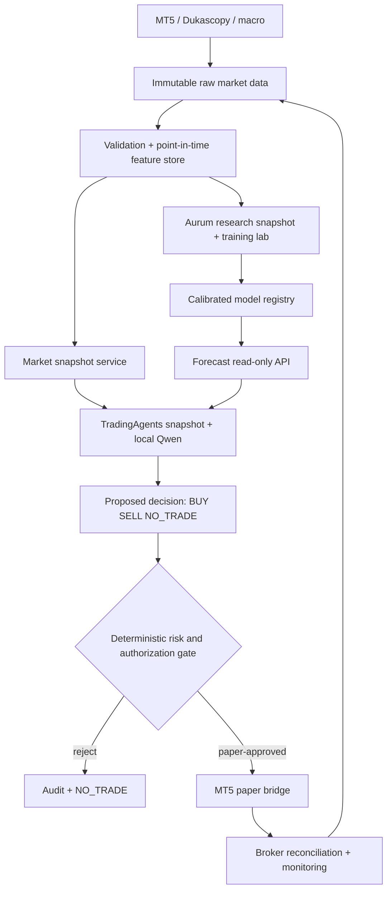

# المعمارية / Architecture v0.1

## شكل النظام

## حدود المسؤوليات

| المكوّن | مسؤولياته | ممنوع عليه |
|---|---|---|
| Market data | جمع/توقيت/تدقيق/تخزين البيانات | إعادة كتابة البيانات الخام |
| Research lab | Label/Features/Splits/Models/Backtests | إرسال أوامر إلى الوسيط |
| Forecast service | احتمالات ونسخة نموذج وبصمة مدخلات | إصدار أمر مباشر |
| Agent council | فهم السياق وتلخيص الأدلة والتعارضات | تغيير قيمة توقع/حد مخاطرة |
| Risk gateway | حساب المخاطرة من specs الوسيط وفحص القرار | تجاوز الحد الأدنى للوت لتمرير إشارة |
| Execution bridge | إرسال أوامر paper عند اعتمادها ومطابقة الحالة | التخمين عند انقطاع الشبكة أو تكرار أمر |
| Model registry | قبول/رفض/استعادة نماذج مع نسخها | اعتماد نموذج تلقائيًا بسبب عائد فوري |

## العقود / Interface contracts

- `MarketSnapshot`: asset, symbol, broker, server_time, utc_time, available_at_utc, bid, ask, spread_points, timeframe, bar_complete, source_hash, freshness_seconds.
- `Forecast`: dataset_hash, model_id, model_sha, produced_at_utc, valid_until_utc, horizon, probabilities, calibration_version, uncertainty, feature_hash.
- `AgentRecommendation`: `BUY | SELL | NO_TRADE`, reasons, evidence_ids, input_forecast_id, contradictory_evidence, confidence_language, never invented numeric odds.
- `TradeProposal`: side, symbol, entry, stop, target, risk intent, signal timestamp, idempotency key, source model.
- `RiskDecision`: allowed, reason codes, lots (only if allowed), risk_budget, broker-spec snapshot, timestamp.
- `ExecutionEvent`: proposal id, broker request id, broker order/deal id, status, retcode, observed time, reconciliation state.

كل عقد يُربط بإصدار Schema ووقت وتوقيع/تجزئة. البيانات المنقوصة ترفض دون تعبئة تخمينية. جميع أزمنة الاستدلال موحدة UTC بعد تحويل مثبت من توقيت خادم الوسيط.

## Initial code composition

- Our own Python package `goldintel` = policy/data contracts/security orchestration.
- Aurum = **frozen research reference**; candidates for selective internal port after isolated tests.
- TradingAgents = **frozen agent/orchestration reference**; adapt data tools to gold and remove equity fundamentals.
- Midas = **ideas and optional selective snapshot**; not authoritative strategy.
- Chronos, NeuralForecast, LightGBM, CatBoost = pinned upstream *dependencies*, not copied source unless necessary; trained checkpoints are our artifacts.
- AGPL projects = architecture references only until a licensing decision changes.

## Upgrade/replacement policy

Version every interface. Internal package fixes via feature branches and tests. Never runtime-pull external code or models. No git submodule following a remote; no automatic framework source refresh. Preserve modified snapshots and attribution.
